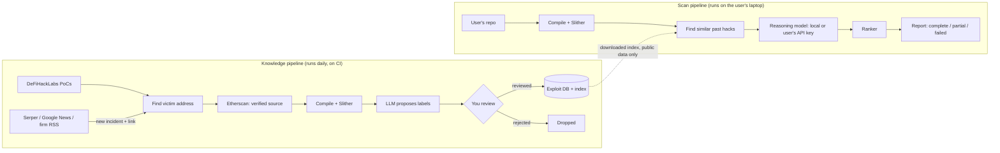

# The PRD, explained (v0.3)

Plain-English walkthrough of [PRD.md](PRD.md). Written 2026-10-22.
Labels used below: **Fact** = measured or checked today. **Plan** = what the PRD proposes. **Unknown** = M0 must measure it.

---

## 1. What the tool does, in one paragraph

You point the tool at a Solidity project on your laptop. It compiles the project and runs Slither. It looks up real past hacks that resemble each risky spot. A reasoning model reads the code, the Slither warnings, and those past hacks. It returns a short ranked list. Each item says why it matters, which real hack it resembles, and what it could not check. In local mode, your code does not leave your laptop.

## 2. The two halves of the system

There are two separate pipelines. One builds knowledge. The other uses it.

Key point: news (Serper, X) only **finds** hacks. It does not become training text. The training example comes from the victim's code plus the reviewed root cause.

## 3. One input, traced end to end

*Invented example, for illustration only.*

1. A user runs `hindsight scan ./lending-vault`.
2. The project compiles. Slither prints 64 findings.
3. One function, `getCollateralPrice()`, reads token reserves straight from a DEX pair. Slither does not flag this. It is a logic problem, not a code pattern.
4. Retrieval finds three past incidents where a protocol trusted a DEX spot price and lost funds to a flash-loan price manipulation.
5. The model reads `getCollateralPrice()` and those three incidents. It flags the function as `high`. It tags the issue `source = model` because Slither did not find it.
6. The report says: "Matches: spot-price read from a pair. Not established: whether the pair has low enough liquidity to manipulate cheaply."
7. The other 63 Slither findings stay in the report, ranked lower.

This is the case the PRD calls **beyond-Slither**. If this happens often, the product is valuable. If it never happens, the tool is only a Slither sorter.

## 4. A failure case, and what the tool does

The user's project imports a dependency that is not installed. The compile fails. Slither cannot run.

- **Wrong behavior:** report "no issues found". That would be a false all-clear.
- **PRD behavior (OUT-1):** report `partial`, name the missing dependency, and show only what the model could check from raw source.

## 5. How the PRD keeps the scores honest

A benchmark can lie in many ways. The PRD blocks the main ones:

| Leak | Example | Block |
|---|---|---|
| Answer in the search index | Test hack from September; the index already holds its post-mortem | Search only sees documents published before the test date |
| Answer in the input | PoC file header explains the bug | Strip PoC comments before eval |
| Same bug twice | Ten forks of one vault, all hacked | Group forks into families; a family is in train or test, never both |
| Model memorized it | Old 2020 code hacked in 2026; model saw the code in pretraining | Report results split by code age and model cutoff |
| Tuning on the test | Picking models by the same holdout each month | Sealed test, touched once per milestone |

## 6. Your questions, answered

**Why Solidity only?** **Fact:** almost all Ethereum victims in DeFiHackLabs are Solidity, and Slither, Etherscan, and Foundry work best with it. **Plan:** Vyper next (Slither supports it). Solana is a separate parser and dataset.

**Would people use it?** **Unknown, and the main risk.** **Fact:** Trail of Bits already ships Slither-MCP, so anyone can connect Claude Code to Slither today. That is most of this tool without the exploit database. So the database, the benchmark, and calibrated output must carry the value. **Plan:** an adoption gate at M2: ten outside users. If fewer than three would use it again, change direction before more work.

**Local / privacy?** **Plan:** headline is "Runs on your machine. Your code is never uploaded unless you turn on API mode." The PRD lists exactly what is downloaded (public index, compilers, your declared deps) and what never leaves. It also says local mode is less accurate. That honesty matters, because auditors will check.

**Scrape Serper or X for news?** **Plan:** yes to Serper / Google News for discovery and backfill. That is a paid API, not scraping. X only through its official paid API. **Fact:** DeFiHackLabs had months with only 1–6 new entries (2025-09 to 2026-02). Independent news discovery fills those gaps. That supports your idea.

**Train now on older hacks?** Not yet. With no reviewed labels and no benchmark, you cannot tell if training helped. The older hacks still get used: they become the dataset and the retrieval index first.

**Use Lightning AI credits?** Yes, starting now, for labeling ~900 incidents with a large open model, embeddings, and open-model baselines. Fine-tuning waits for M5.

## 7. Verdict: ready to go?

**Ready to start M0. Not ready to build M1 or later.**

That is by design. M0 is 1–2 weeks of hand work on 30–50 Ethereum incidents. It answers the four unknowns that decide everything after it:

| Unknown | If good | If bad |
|---|---|---|
| Minutes to review one incident | Larger dataset | Smaller dataset, more LLM pre-fill |
| How often Slither flags the real bug | Sorting Slither is a real product | Beyond-Slither becomes the product |
| Claude Code + Slither-MCP on the same set | Gap exists for the exploit DB to fill | Pivot to dataset + benchmark |
| Incidents found by Serper that DeFiHackLabs missed | News discovery is worth its cost | Keep it light |

**Non-blocking items for you:** tell me your MacBook RAM, and your Lightning credit amount and expiry.
