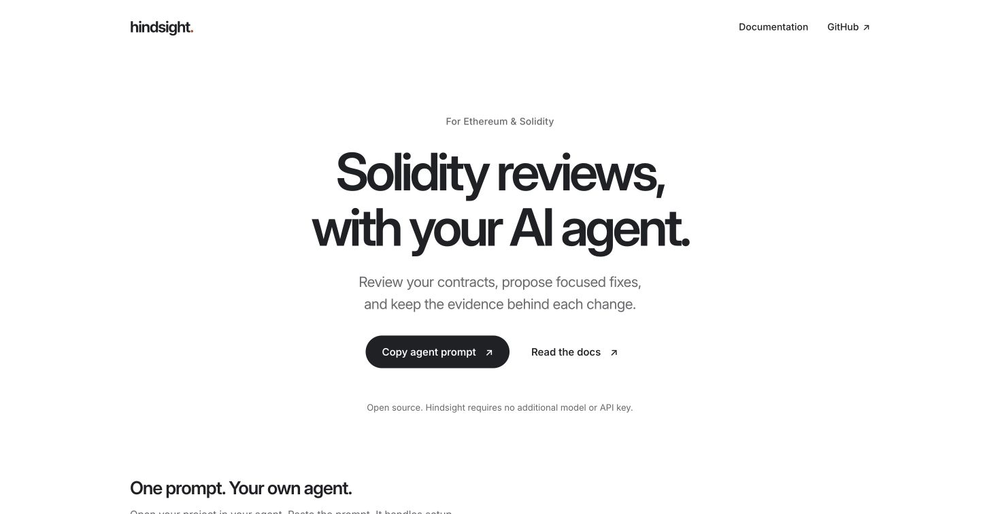

# Hindsight

**Review Solidity contracts with your AI agent. Contribute evidence from real hacks.**

[Live website](https://hindsight-solidity.pages.dev/) ·
[Documentation](https://hindsight-solidity.pages.dev/docs/)

[](https://hindsight-solidity.pages.dev/)

Hindsight is an agent skill and review toolkit for **Ethereum mainnet + Solidity**.
Your agent reads the code and explains possible bugs. Hindsight prepares the source
and checks that the report points to the files actually reviewed.

It also maintains a separate catalog of reported incidents. The current review
workflow is code-only by default. The optional [MCP server](docs/site/mcp.md)
lets compatible agents search current incident metadata and evidence links.

Start with the [documentation overview](docs/site/index.md) or
[getting-started guide](docs/site/getting-started.md). The website includes searchable
VitePress documentation at `/docs/`, linked from the header, hero and footer.

## Review your project

1. Open the project you want reviewed in your AI coding agent.
2. Paste the prompt below. Your agent handles obtaining the toolkit separately.
3. Read the findings, suggested fixes and coverage gaps before making changes.

```text
Review the Solidity contracts in my current codebase using https://github.com/Shawnchee/hindsight.
Keep this codebase as the target and obtain Hindsight in a separate tools folder.
Read Hindsight's AGENTS.md, skills/hindsight-triage/SKILL.md and its report reference.
Confirm the chain and contracts. Perform a code-only review and validate the report if the helpers can run; otherwise say validation was not run.
Explain supported findings with file/line evidence, impact, proposed fixes and remaining uncertainty.
Review only: do not edit or deploy my project, read secrets, run untrusted scripts on the host, install dependencies or download models.
```

Use an agent that can read links and local files. Running the helpers requires
**Python 3.11+**; no extra Python packages, API key or custom model are needed.
You do not need to clone Hindsight manually or install a skill manager.

A review should give you supported findings, source references, proposed fixes
and an honest account of what was not checked. **No findings does not mean safe.**
Report validation checks structure and references, not whether a bug is real.
Hosted agents may send source to their provider; use a local agent for local-only review.

Want the agent to make changes afterward? Use the
[review-and-fix workflow](skills/hindsight-triage/references/remediation.md).
Compilation and runtime checks are separate; see [runtime testing](docs/runtime-checks.md).

## Add a reported hack through a pull request

**New and historical incidents are welcome. You do not need a working exploit.**
Current intake covers Ethereum mainnet and Solidity. Submit public evidence links
and your own summary; mark anything you cannot verify as unknown.

1. [Fork this repository](https://github.com/Shawnchee/hindsight/fork) and create a branch.
2. Copy [the example record](incidents/examples/example.json) into
   `incidents/submissions/community_protocol_incident.json`.
3. Fill in the incident name, primary report link, your summary and known dates or
   identifiers. Set `discovered_at` to the day you found the report; use `null` for
   an unknown incident date. Match `candidate_id` to the filename without `.json`. Keep the
   proposed/unresolved and eligibility fields unchanged.
4. Check the [catalog](m0/catalog/ethereum_incidents.csv),
   [existing submissions](incidents/submissions/) and open issues for duplicates.
   Update an existing submission when you have better evidence for the same incident.
   If it only exists in the catalog or a frozen snapshot, open a correction issue.
5. Run the checks, then open a pull request from your branch to `Shawnchee/hindsight:main`.
   Explain what happened, link the evidence and list the remaining gaps.

```sh
python3 -I scripts/incidents/validate.py --root incidents/submissions
python3 -I scripts/check.py
```

Your agent can help prepare the PR:

```text
Read CONTRIBUTING.md and incidents/README.md in the Hindsight repository.
Prepare an incident submission for this public report: <REPORT_URL>.
Check for duplicates, use links and an original summary, leave unknown facts unresolved,
and run the offline validator. Keep all review and eligibility flags unchanged.
Show me the proposed record and remaining gaps before submitting a pull request.
```

See [CONTRIBUTING.md](CONTRIBUTING.md) for the full steps and field guidance.
If you only have a useful link, [open an incident issue](https://github.com/Shawnchee/hindsight/issues/new/choose).

**Never include secrets, copied articles, private reports, raw contract source or
working exploit code.** For an undisclosed vulnerability in a live protocol,
use that protocol's security channel instead of a public PR here.

A merged submission is a research lead, not a verified vulnerability. Maintainers
review scope, evidence, source rights and missing information before adding it to
a new research snapshot. Frozen datasets are not edited by contribution PRs.

## What data is included?

| Collection | What it contains |
| --- | --- |
| [Live catalog](https://github.com/Shawnchee/hindsight/blob/main/website/data/catalog.json) | Historical baseline plus qualifying, explicitly provisional DeFiHackLabs metadata additions |
| [Historical baseline](m0/catalog/ethereum_incidents.csv) | 357 entries classified as Ethereum, pinned to 21 October 2026 |
| [Research snapshot v0.2.0](datasets/research/v0.2.0/README.md) | 10 incidents with deeper source research and 55 component records |
| [Community submissions](incidents/submissions/) | Proposed incident leads awaiting review |

The historical baseline and frozen research snapshots remain unchanged. Daily
catalog additions require explicit mainnet metadata, an attack transaction and
a victim contract; ambiguous identity matches stay pending. All reported claims
remain provisional. The enriched snapshot has **zero human-verified labels**.
Components include dependencies and proxies, not separate hacks. These counts
overlap and should not be added together.

Daily RSS and optional SerpAPI searches automatically save unverified reports.
DeFiHackLabs updates feed a separate catalog overlay; one Gemini batch can
summarize up to ten new/changed claims. AI never determines incident counts or
human verification. Counts/charts rebuild automatically; Cloudflare publishing
requires deployment credentials. See [discovery setup](docs/incident-discovery.md)
to enable the scheduled workflow and inspect its latest results.

## More guides

| I want to… | Read |
| --- | --- |
| Run the source helpers myself | [Skill guide](docs/hindsight-skill.md) |
| Understand the report format | [Report reference](skills/hindsight-triage/references/report.md) |
| Search incidents from my agent | [MCP connection](docs/site/mcp.md) |
| Build the landing page and docs | [Website setup](docs/README.md) |
| Inspect dataset limits | [Research snapshots](datasets/research/README.md) |
| Work on the toolkit as an agent | [AGENTS.md](AGENTS.md) |

## License

Hindsight's own code and original documentation use the [MIT License](LICENSE).
Upstream material keeps its own terms, including DeFiHackLabs' Apache-2.0 license
and Inter's SIL OFL. See [third-party notices](THIRD_PARTY_NOTICES.md).
